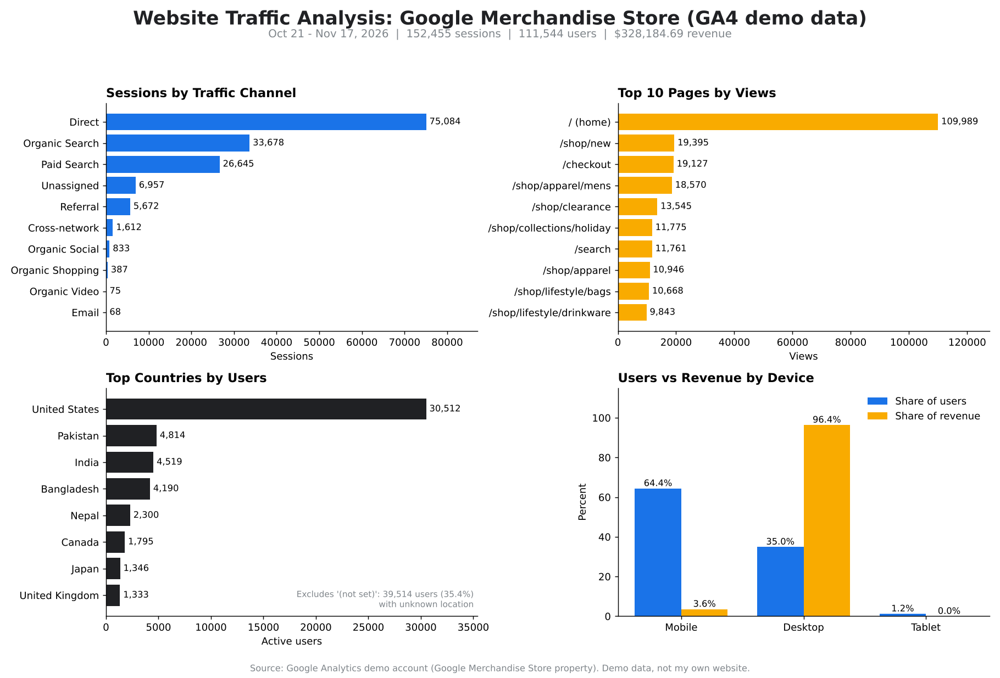

# Website Traffic Analysis: Google Analytics Demo Account

Analysis of the Google Merchandise Store using Google's public GA4 demo account. This is Google's demo data, not my own website.

Date range: Oct 21 - Nov 17, 2026 (152,455 sessions, 111,544 users, $328,184.69 revenue)

## Key findings
- Direct traffic brings the most sessions (75,084, 49.25%) but has a low engagement rate (29.87%).
- Organic Search brings 33,678 sessions (22.09%) with a much higher engagement rate (69.7%).
- Direct, Organic Search, and Paid Search together make up about 88.8% of sessions.
- The home page gets 109,989 views (23.44% of all views), with only about 9 seconds of average engagement time.
- Mobile has 64.4% of users but only 3.6% of revenue. Desktop has 35% of users and 96.4% of revenue.
- Engagement rate is 29.41% on mobile and 65.26% on desktop.

## Notes
- 35.4% of users have no location data ("not set"), so they are left out of the country chart.
- Differences between channels, devices, and countries are patterns worth investigating. This data does not show their causes.

## Tools used
Google Analytics 4 (Traffic acquisition, Pages and screens, Demographic details, Tech details), Python (matplotlib), data interpretation

## Data source
Google Analytics demo account (Google Merchandise Store property)
